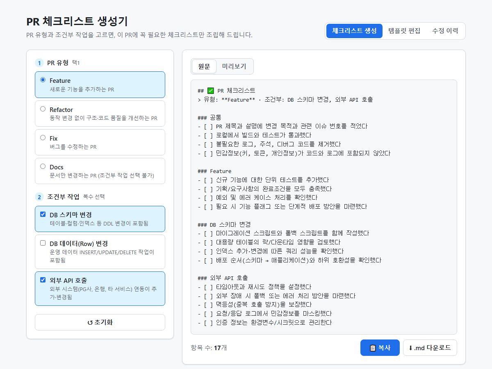
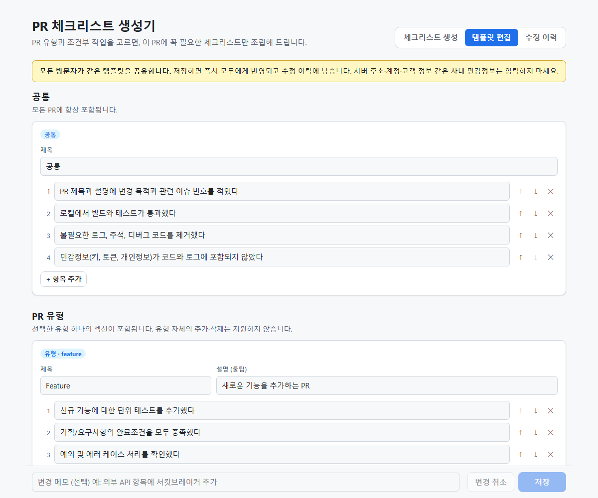

# PR 체크리스트 생성기 (PR Checklist Builder)

> 🔗 **배포 URL: https://pr-checklist-maker.vercel.app/**

PR 유형과 조건부 작업만 고르면 **해당 PR에 꼭 필요한 체크리스트만** Markdown으로 조립해 주는 웹앱입니다.
"지우는 템플릿"에서 "조립하는 템플릿"으로 — 기획 문서는 [PRD.md](./PRD.md)를 참고하세요. (v1.1: 공유 템플릿 편집)



## 사용법

### 체크리스트 생성
1. **PR 유형**을 하나 고릅니다 — `Feature` / `Refactor` / `Fix` / `Docs`
2. 해당되는 **조건부 작업**을 체크합니다 — `DB 스키마 변경` / `DB 데이터(Row) 변경` / `외부 API 호출` 등 (Docs는 선택 불가)
3. **📋 복사**를 눌러 GitHub PR 본문에 붙여넣습니다. (또는 **⬇ .md 다운로드**)

선택 상태는 URL에 반영되므로 링크로 공유할 수 있습니다.

```
https://pr-checklist-maker.vercel.app/?type=fix&cond=db-schema,external-api
```

| 파라미터 | 값 |
|---|---|
| `type` | `feature` \| `refactor` \| `fix` \| `docs` |
| `cond` | 조건부 작업 ID 0개 이상 (쉼표 구분, 순서 무관). 템플릿에 없는 ID는 무시 |

### 템플릿 편집 (v1.1)



- 상단 **템플릿 편집** 탭에서 공통·유형별·조건부 섹션의 제목, 설명, 항목을 추가·수정·삭제하고 순서를 바꿉니다.
- **+ 조건부 작업 추가**로 새 조건(예: 배치 작업 변경)을 만들 수 있습니다. 조건부 섹션은 편집 화면의 순서대로 출력됩니다.
- 변경 메모를 적고 **저장**하면 **모든 방문자에게 즉시 반영**됩니다. 로그인은 없습니다(PoC).
- 편집 중 다른 사람이 먼저 저장했다면 덮어쓰지 않고 충돌을 알립니다. **최신 템플릿 불러오기** 후 다시 수정하세요.
- **수정 이력** 탭에서 최근 20건을 보고, 미리보기 후 **이 버전으로 되돌리기**할 수 있습니다.
- ⚠️ 체크리스트 문구에 서버 주소·계정·고객 정보 같은 사내 민감정보를 쓰지 마세요.

## 구조 — DB 없이 공유하는 방법

```
브라우저 ──/api/templates──▶ Vercel 서버리스 함수 ──GitHub API──▶ 이 저장소의 template-data 브랜치
                                (GITHUB_TOKEN 보관)                  └─ templates.json (커밋 = 수정 이력)
```

- 템플릿은 이 저장소 `template-data` 브랜치의 `templates.json` 한 파일입니다. 저장할 때마다 커밋이 하나씩 생기고, 그 커밋 목록이 곧 수정 이력입니다.
- 동시 수정은 파일의 blob SHA로 막습니다. 저장 요청은 편집을 시작할 때의 버전을 함께 보내고, 그 사이 파일이 바뀌었으면 GitHub이 거부합니다(`409`).
- `template-data` 브랜치는 `vercel.json`에서 배포 대상에서 뺐으므로, 템플릿을 저장해도 재배포가 일어나지 않습니다.
- 브랜치나 파일이 아직 없으면 [내장 기본 템플릿](./src/data/defaultTemplate.ts)을 씁니다. 처음 저장할 때 `main`에서 브랜치를 자동으로 만듭니다.
- API에 문제가 생겨도 내장 기본 템플릿으로 **생성 기능은 계속 동작**합니다(편집만 막힘).

### API

| 메서드 | 경로 | 설명 |
|---|---|---|
| GET | `/api/templates` | 최신 템플릿과 `version` |
| PUT | `/api/templates` | `{ template, baseVersion, message }` 저장. 버전이 다르면 `409`, 검증 실패 시 `400` + 오류 위치 |
| GET | `/api/history` | 최근 수정 이력 20건 |
| GET | `/api/history?version=<sha>` | 해당 버전의 템플릿 |
| POST | `/api/history` | `{ version, baseVersion }` 해당 버전으로 되돌리기 (새 커밋) |

### 환경변수 (Vercel)

| 이름 | 필수 | 기본값 | 설명 |
|---|---|---|---|
| `GITHUB_TOKEN` | ✅ | — | Fine-grained PAT. 대상 저장소 하나에 **Contents: Read and write** 권한만 부여 |
| `GITHUB_REPO` | | `BaeJunH0/pr-checklist-maker` | 템플릿을 저장할 저장소 |
| `TEMPLATE_BRANCH` | | `template-data` | 템플릿 전용 브랜치 |
| `TEMPLATE_BASE_BRANCH` | | `main` | 전용 브랜치가 없을 때 분기할 브랜치 |
| `TEMPLATE_PATH` | | `templates.json` | 브랜치 안의 파일 경로 |

## 기능 충족 현황

| ID | 기능 | 우선순위 | 상태 |
|---|---|---|---|
| F-01 | PR 유형 선택 (라디오, 택1) | P0 | ✅ |
| F-02 | 조건부 작업 선택 (체크박스, 복수) | P0 | ✅ |
| F-03 | 체크리스트 생성 (공통 + 유형별 + 조건부) | P0 | ✅ |
| F-04 | 실시간 미리보기 (원문 / 렌더링 탭) | P0 | ✅ |
| F-05 | 복사하기 + "복사됨" 피드백 | P0 | ✅ |
| F-06 | `pr-checklist.md` 다운로드 | P1 | ✅ |
| F-07 | URL 쿼리스트링 상태 공유 | P1 | ✅ |
| F-08 | Docs 선택 시 조건부 비활성화 + 선택 해제 | P1 | ✅ |
| F-09 | 공유 템플릿 로드 (실패 시 내장 템플릿) | P0 | ✅ |
| F-10 | 템플릿 편집 (제목·설명·항목 추가/수정/삭제/순서) | P0 | ✅ |
| F-11 | 조건부 작업 추가·삭제·순서 변경 | P0 | ✅ |
| F-12 | 저장·충돌 감지 | P0 | ✅ |
| F-13 | 수정 이력·되돌리기 | P1 | ✅ |

## 완료 조건 충족 현황

검증 방식: 🧪 단위 테스트(`src/lib/*.test.ts`, `server/handlers.test.ts`) · 🖥 브라우저 수동 검증

| ID | 시나리오 | 상태 | 검증 |
|---|---|---|---|
| AC-01 | 유형 미선택 → 안내 문구, 복사/다운로드 비활성 | ✅ | 🧪 🖥 |
| AC-02 | `Feature`만 선택 → 공통 + Feature만 출력 | ✅ | 🧪 |
| AC-03 | `Fix` + `DB 데이터 변경` → 공통 → Fix → DB 데이터 순서 | ✅ | 🧪 |
| AC-04 | `Feature` + 조건부 3개 → 5개 섹션 고정 순서 | ✅ | 🧪 |
| AC-05 | 조건부 선택 후 해제 → 헤더 포함 즉시 제거 | ✅ | 🧪 🖥 |
| AC-06 | `Refactor` → `Fix` 변경 → 유형 섹션만 교체 | ✅ | 🧪 🖥 |
| AC-07 | `Docs` 선택 → 조건부 비활성 및 선택 해제 | ✅ | 🧪 🖥 |
| AC-08 | 복사 → 클립보드에 원문 복사, "복사됨" 표시 | ✅ | 🖥 |
| AC-09 | 다운로드 → `pr-checklist.md`, 미리보기와 동일 내용 | ✅ | 🖥 |
| AC-10 | `?type=fix&cond=db-schema,external-api` 접속 → 상태 복원 | ✅ | 🧪 🖥 |
| AC-11 | GitHub PR 본문 붙여넣기 → 체크박스 렌더링 | ✅ | 🧪 (`- [ ]` 문법 검증) |
| AC-12 | 항목 문구 수정 후 저장 → 새로고침 후에도 반영 | ✅ | 🧪 🖥 |
| AC-13 | 조건부 작업 추가 후 저장 → 체크박스·섹션 출력 | ✅ | 🧪 🖥 |
| AC-14 | 조건부 순서 변경 → 출력 순서 반영 | ✅ | 🧪 🖥 |
| AC-15 | 동시 편집 후 차례로 저장 → 나중 저장 거부, 먼저 저장 보존 | ✅ | 🧪 🖥 |
| AC-16 | 잘못된 입력 저장 → 거부 및 오류 위치 안내 | ✅ | 🧪 🖥 |
| AC-17 | 이전 버전으로 되돌리기 → 복원 + 새 이력 | ✅ | 🧪 🖥 |
| AC-18 | API 장애 시 → 내장 템플릿으로 생성 동작, 편집 불가 안내 | ✅ | 🖥 |

**비기능**

| 항목 | 상태 | 비고 |
|---|---|---|
| 선택 변경 후 100ms 이내 갱신 | ✅ | 템플릿은 접속 시 1회 로드, 이후 생성은 브라우저 안에서만 계산 |
| 모바일(375px) 가로 스크롤 없음 | ✅ | 생성·편집 화면 모두 375px에서 `scrollWidth = clientWidth` 확인 |
| API 장애 시에도 생성 기능 동작 | ✅ | 내장 기본 템플릿으로 대체 |

## 개발

```bash
npm install
npm run dev      # http://localhost:5173 (/api/* 포함)
npm test         # 생성 규칙 · 템플릿 검증 · API 핸들러 · GitHub 저장소 단위 테스트
npm run build    # dist/ 빌드
```

`GITHUB_TOKEN` 없이 `npm run dev`를 실행하면 `/api/*`는 `.local-data/templates.json`(Git 무시)에 저장합니다. GitHub 저장소와 같은 방식으로 충돌을 감지하고 이력을 남깁니다.

### 디렉터리

```
api/                      # Vercel 서버리스 함수 (templates, history)
server/
├─ handlers.ts            # 요청 검증 · 오류 매핑 · 저장소 선택
├─ githubStore.ts         # GitHub Contents API 저장소 (낙관적 잠금, 이력)
└─ localStore.ts          # 로컬 개발용 파일 저장소
src/
├─ data/defaultTemplate.ts  # 내장 기본 템플릿
├─ lib/template.ts          # 템플릿 스키마 · 검증 (서버·클라이언트 공통)
├─ lib/generate.ts          # 선택값 정규화 + Markdown 생성
├─ lib/urlState.ts          # 쿼리스트링 ↔ 선택값
├─ lib/api.ts               # API 클라이언트
├─ lib/renderMarkdown.ts    # 미리보기용 경량 렌더러 (HTML 이스케이프)
└─ components/              # Generator · Editor · History
```

## PoC 한계

- 인증이 없어 URL을 아는 사람은 누구나 템플릿을 수정할 수 있습니다. 대신 모든 변경이 커밋으로 남아 되돌릴 수 있습니다.
- 요청 횟수 제한(rate limit)은 없습니다. 템플릿을 저장할 때마다 서버 쪽 GitHub 토큰으로 커밋하므로, 쓰기 요청이 몰리면 GitHub API 한도(시간당 5,000회)에 걸릴 수 있습니다.
- 템플릿은 하나만 운영합니다(팀별 템플릿 없음).

## 기술 스택

React 18 · TypeScript · Vite · Vitest · Vercel Functions · GitHub Contents API
